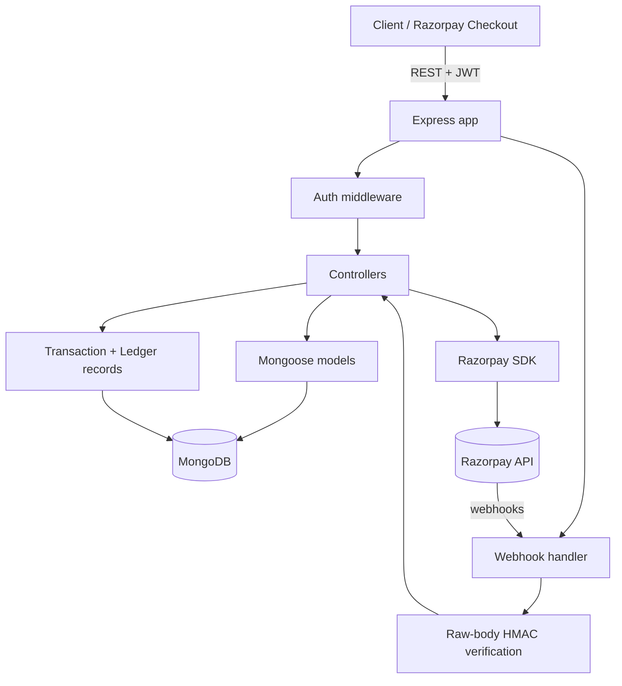
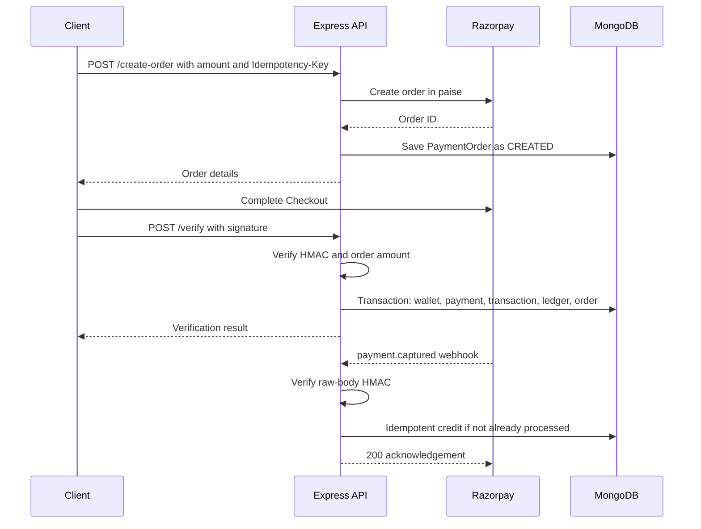
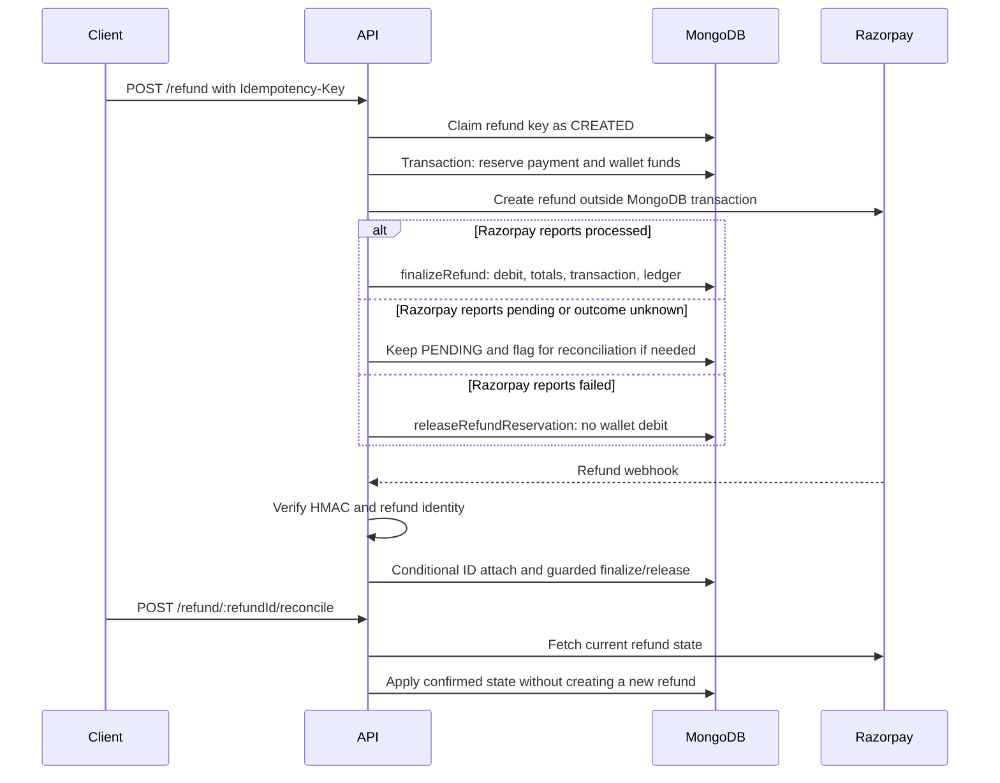

# Wallet / Payment Gateway Engineering Project

A Razorpay-backed wallet API built with TypeScript, Express, MongoDB, and Mongoose. It models user wallets, Razorpay-funded top-ups, wallet transfers, transaction history, append-only ledger records, and a reservation-based refund lifecycle with idempotency and reconciliation support.

This is an engineering project that **integrates Razorpay**. It is not an independently operating licensed payment gateway.

| Area | Summary |
|---|---|
| Stack | TypeScript, Express 5, MongoDB/Mongoose, Razorpay SDK, JWT, bcrypt |
| Core capabilities | Authentication, wallets, Razorpay orders and verification, webhooks, transfers, ledger records, refunds, manual reconciliation |
| Engineering focus | Integer paise, idempotency keys, atomic conditional updates, MongoDB transactions, raw-body webhook HMAC verification |
| Status | API implemented; no automated refund worker/scheduler and no automated test suite |

### 1. Project Overview

**Project name:** Wallet / Payment Gateway Engineering Project

The application exposes a REST API for:

- registering users and creating a wallet for each user;
- funding a wallet through Razorpay orders and payment verification;
- transferring money between wallets;
- reading wallet balances and paginated transaction history;
- creating and processing partial or full refunds;
- recording wallet movements in transaction and ledger collections;
- handling Razorpay webhooks and manually reconciling uncertain refunds.

The main engineering objective is to model reliable money movement in a backend service where retries, duplicate webhooks, concurrent requests, and ambiguous external-provider outcomes are expected rather than exceptional.

This project was built to explore the backend problems that appear in payment systems: preserving financial consistency, preventing duplicate credits and refunds, protecting balances under concurrent updates, keeping an audit trail, and coordinating MongoDB state with an external provider that cannot be rolled back.

### 2. Problem Statement

| Engineering problem | Failure mode this project guards against | Approach in this repository |
|---|---|---|
| Safe money movement | A wallet is credited without a verified payment, or debited twice | Signature verification, guarded state transitions, and MongoDB transactions |
| Duplicate payment/transaction prevention | A retry creates a second credit or transfer | Unique idempotency keys, unique provider IDs, and re-checks inside transactions |
| Idempotent API operations | The same request produces different results when repeated | Request fingerprints and database-level unique indexes |
| Concurrent wallet operations | Two requests spend the same balance | Atomic `$inc` updates with `$expr` balance guards |
| Transaction consistency | Wallet, payment, transaction, and ledger records disagree | Multi-document MongoDB transactions for related writes |
| Payment verification | A forged checkout response is treated as a real payment | HMAC verification of the order ID and payment ID pair with `crypto.timingSafeEqual` |
| Refund lifecycle management | An unconfirmed refund is reported as complete, or funds are released too early | Reservation model, explicit states, webhook validation, and manual reconciliation |
| Financial record keeping | Balance changes cannot be explained or audited | Append-only ledger rows with `balanceBefore` and `balanceAfter` |

These problems matter because money movement systems must remain correct under retries and partial failure. A normal application can often retry an operation; a payment system must know whether the retry represents a new operation or a replay of one that already moved money.

### 3. Technology Stack

| Technology | Declared version/source | Purpose in this project |
|---|---|---|
| Node.js | Runtime used by the npm scripts | Executes the API server with `ts-node` |
| TypeScript | `^5.9.3` | Strictly typed source code; `strict: true` in `tsconfig.json` |
| Express | `^5.2.1` | HTTP routing, JSON body parsing, JSON 404 responses, central error handler |
| MongoDB | Database targeted by `mongoose.connect` | Persistent storage and multi-document transactions |
| Mongoose | `^9.9.5` | Schemas, validation, indexes, transactions, and model queries |
| Razorpay SDK | `^2.9.8` | Order creation, order fetch, refund creation, and refund lookup |
| bcrypt | `^6.0.0` | Password hashing and comparison |
| jsonwebtoken | `^9.0.3` | Signs and verifies JWTs containing `userId` |
| Node `crypto` | Built-in module | HMAC signature checks and SHA-256 request fingerprints |
| dotenv | `^17.4.2` | Loads environment variables in `server.ts` |
| ts-node | `^10.9.2` | Runs TypeScript directly in `dev` and `start` scripts |
| nodemon | `^3.1.14` | Restarts the development server on file changes |
| cookie-parser | `^1.4.7` | Declared dependency; no usage was found in the current source |

There is no test framework, linter, or Markdown linter configured in `package.json`.

### 4. System Architecture

| Component | Responsibility |
|---|---|
| Client / API layer | Sends REST requests with JWTs and idempotency keys; Razorpay Checkout runs externally |
| Express server | Mounts `/api/auth`, `/api/wallet`, and `/api/payment`; captures the raw webhook body |
| Authentication middleware | Verifies the bearer JWT and attaches `req.user.userId` |
| Controllers | Implement registration, wallet operations, payment flows, webhooks, refunds, and reconciliation |
| Mongoose models | Define validation, indexes, relationships, and money-field constraints |
| MongoDB | Stores users, wallets, orders, payments, transactions, ledger rows, and refunds |
| Ledger layer | Append-only accounting records linked to transactions and wallets |
| Razorpay integration | Creates orders/refunds and fetches provider state; called outside MongoDB transactions |
| Webhook handling | Verifies the raw-body HMAC and applies idempotent state transitions |



The server starts only after `connectDB()` succeeds. A MongoDB connection failure is logged and the process exits, so the API does not listen without a database.

### 5. Core Features

All items below were verified against the current source.

| Feature | Implementation summary |
|---|---|
| User registration | Creates a `User` and a zero-balance `Wallet` in one MongoDB transaction; password is hashed with bcrypt |
| User login | Verifies the password, checks that the account is active, and returns a JWT with a 1-day expiry |
| JWT authentication | `authenticateUser` reads `Authorization: Bearer <token>` and verifies it with `JWT_SECRET` |
| Wallet lookup | Returns balance, reserved balance, available balance, currency, and status |
| Direct wallet credit | Implemented but gated behind a local/development opt-in flag; requires an idempotency key |
| Wallet-to-wallet transfer | Atomic sender debit and receiver credit with idempotency and balance guards |
| Transaction history | Cursor-paginated query with a capped page size; internal fingerprint fields are excluded |
| Razorpay order creation | Converts rupees to paise, applies an idempotency key, and stores a `PaymentOrder` |
| Payment verification | Verifies checkout signature, order ownership, and amount before a transactional wallet credit |
| Payment status lookup | Returns the local `PaymentOrder` status for an authenticated user |
| Payment webhooks | Handles `payment.captured` and `payment.failed` after verifying the raw-body signature |
| Ledger records | Writes append-only `CREDIT`/`DEBIT` entries with balance snapshots |
| Refund creation | Claims an idempotency key, reserves capacity and wallet funds, then calls Razorpay |
| Refund processing | Finalizes processed refunds or releases reservations for failed refunds |
| Refund webhooks | Validates refund identity and financial fields before applying a guarded transition |
| Manual refund reconciliation | Fetches provider state and applies a confirmed result without creating a new refund |
| Idempotency protection | Unique indexes and request fingerprints on wallet operations and refunds |

A withdrawal endpoint is not implemented.

### 6. Important Engineering Decisions

#### Money representation

All stored money values are **integer paise**. User-facing endpoints accept rupees as numbers, then convert them with `Math.round(amount * 100)` before persistence.

Storing integers avoids binary floating-point errors such as `0.1 + 0.2 !== 0.3`. The wallet, transaction, ledger, payment, and refund schemas validate integer amounts, and payment/refund paths add explicit range and safe-integer checks.

Examples:

- `₹250.50` is stored as `25050` paise.
- `Wallet.balance` includes reserved funds.
- `Wallet.availableBalance = balance - reservedBalance`.

#### Idempotency

The API uses an `Idempotency-Key` header on wallet credits, transfers, order creation, and refund creation.

| Flow | Behavior on retry |
|---|---|
| Add money / transfer | `Transaction.idempotencyKey` is unique. A SHA-256 request fingerprint proves the retry has the same type, wallets, amount, and currency. Same key with different parameters returns `409`. |
| Create order | Lookup is scoped by idempotency key and user; the existing order is returned. This path does **not** compare the original amount, so reusing a key with a different amount returns the original order. |
| Create refund | `Refund.idempotencyKey` is unique and is claimed before Razorpay is called. A different user or different payment details with the same key returns `409`; an in-progress refund returns `202`. |
| Webhooks | Duplicate deliveries are absorbed by unique provider IDs, unique transaction keys, and guarded refund state transitions. |

The `PaymentOrder.idempotencyKey` field is globally unique in the schema, so the same key submitted by a different user is a database conflict rather than a replay.

Idempotency is enforced at the database level with unique indexes, not only by application checks. This matters because two concurrent requests can both pass an initial read before either insert commits.

#### Database transactions

MongoDB transactions are used where several related writes must commit together:

- user registration and wallet creation;
- Razorpay payment verification;
- `payment.captured` webhook credit;
- wallet credits and transfers;
- refund reservation, finalization, and release.

`session.withTransaction()` is used in the payment, wallet, and refund paths. The callback re-reads current state on each attempt, so a driver retry does not replay stale assumptions. After an uncertain commit error, the refund helpers do not abort the session and do not treat the callback result as proof of success; they re-read the refund and preserve terminal `PROCESSED`/`FAILED` states.

For wallet credits and transfers, an uncertain commit is followed by a lookup of the idempotency key. If the original transaction is present and the fingerprint matches, the API replays the earlier result instead of reporting a failure.

Multi-document MongoDB transactions require a replica set; a standalone local MongoDB instance is not sufficient for these paths.

#### Wallet concurrency

Wallet balances are changed through conditional atomic updates rather than read-modify-write:

- `addMoney` and payment credits use `$inc` with active-status filters;
- transfers debit the sender only if `balance - reservedBalance >= amount`;
- refund reservation holds funds with `$inc: { reservedBalance: amount }`;
- refund finalization requires the reservation to exist before debiting `balance` and `reservedBalance`;
- refund release requires the reserved counters to exist before decrementing them.

The `$expr` guards are important because Mongoose document validators do not run for update operators such as `$inc`. The database filter is therefore the authoritative protection against overdraw and over-refund.

#### Ledger-style record keeping

The `Transaction` model records the business event: `CREDIT`, `DEBIT`, or `TRANSFER`, its amount, status, wallet references, idempotency key, and internal request fingerprint.

The `Ledger` model records per-wallet balance movement: `CREDIT` or `DEBIT`, amount, `balanceBefore`, `balanceAfter`, currency, and a link to the transaction. Ledger rows are immutable through Mongoose hooks and have a unique index on `(transactionId, walletId, type)`.

A transfer writes two ledger rows linked to one transaction: a debit for the sender and a credit for the receiver. Refunds write one debit ledger row for the customer wallet.

This is **ledger-style record keeping**, not full double-entry accounting. There is no chart of accounts, no global debit-equals-credit invariant, and no ledger API in this repository.

### 7. Payment Flow

1. The client calls `POST /api/payment/create-order` with an amount in rupees and an idempotency key.
2. The backend converts the amount to paise, calls `razorpay.orders.create()`, and stores a `PaymentOrder` with status `CREATED`.
3. The client completes Razorpay Checkout externally.
4. The client calls `POST /api/payment/verify` with `razorpay_order_id`, `razorpay_payment_id`, and `razorpay_signature`.
5. The backend verifies the HMAC of `order_id|payment_id`, checks order ownership and the stored amount, and fetches the order from Razorpay.
6. Inside one MongoDB transaction, the backend credits the wallet, creates `Payment`, `Transaction`, and `Ledger` records, and marks the order `PAID`.
7. A `payment.captured` webhook can perform the same credit if verification was not called first. Its signature is checked against the exact raw request body.
8. A `payment.failed` webhook marks a still-`CREATED` order as `FAILED`.



### 8. Refund Architecture

Refunds are modeled as a state machine because Razorpay and MongoDB cannot share one atomic transaction. A MongoDB rollback cannot undo a refund that Razorpay has already created.

#### Lifecycle

| State | Meaning | Reservation |
|---|---|---|
| `CREATED` | Idempotency key claimed; initial refund row written before Razorpay | `reservationActive` starts as `false`, then becomes `true` after the reservation transaction commits |
| `PENDING` | Razorpay accepted the refund or its outcome is unknown; no wallet debit yet | Normally active; funds remain reserved |
| `PROCESSED` | Razorpay processed the refund and local wallet accounting was committed | Inactive; wallet debited once |
| `FAILED` | The refund will not happen and the reservation was released | Inactive; wallet not debited |

`requiresReconciliation` is a separate flag for rows whose final state could not be confirmed. It is not a background job trigger.

#### Creation and reservation

`POST /api/payment/refund` accepts a MongoDB `Payment` ID, an amount in rupees, and an optional reason. The stored payment amount is the source of truth.

Before calling Razorpay:

1. The idempotency key is claimed by inserting a `Refund` row with a unique index.
2. A MongoDB transaction marks the refund reservation active.
3. `Payment.reservedRefundAmount` is incremented only if `refundedAmount + reservedRefundAmount + new amount <= payment.amount`.
4. `Wallet.reservedBalance` is incremented only if `balance - reservedBalance >= amount`.

The external Razorpay call happens **after** this reservation commits. Keeping Razorpay outside the MongoDB transaction avoids holding a database transaction open across a network call and avoids pretending an external refund can be rolled back.

#### Provider outcomes

| Razorpay result | Local action |
|---|---|
| `processed` | `finalizeRefund()` debits the wallet, moves reserved capacity into `refundedAmount`, and writes one DEBIT transaction and ledger row |
| `pending` | Keep the reservation active; return `202`; no wallet debit |
| `failed` | `releaseRefundReservation()` clears the reservation; no wallet debit |
| Definitive API rejection | Release the reservation |
| Timeout, 5xx, or ambiguous error | Keep `PENDING`, set `requiresReconciliation`, and return `202` |

`finalizeRefund()` and `releaseRefundReservation()` use guarded status transitions and MongoDB transactions. They re-read state if a transaction is retried, avoid unsafe aborts after uncertain commits, and never overwrite terminal states.

#### Webhooks and manual reconciliation

Refund webhooks verify the raw-body HMAC, then validate the incoming entity against the local refund: `id`, `payment_id`, `amount`, `currency`, and optional `receipt`. A stored Razorpay refund ID must match the incoming ID. A conditional update attaches a missing ID without overwriting a different one. Conflicts return `409`; unresolved processing returns `503` so Razorpay can retry. Success is acknowledged only when the persisted refund document confirms a terminal state.

Manual reconciliation is available through `POST /api/payment/refund/:refundId/reconcile`. It fetches the refund from Razorpay by stored ID, or searches refunds by receipt with a 100-item page size and a 20-page limit. It validates identity and financial fields before finalizing, releasing, or flagging the refund.



There is **no automated refund reconciliation worker, queue, cron job, or scheduler** in the repository. Reconciliation is manual HTTP reconciliation plus Razorpay webhooks.

### 9. API Documentation

Authentication is a bearer JWT in the `Authorization` header unless noted otherwise. The webhook endpoint is authenticated by the Razorpay raw-body HMAC instead.

#### Authentication

| Method | Endpoint | Auth | Purpose | Important request fields |
|---|---|---|---|---|
| POST | `/api/auth/registration` | None | Register a user and create a wallet | `name`, `email`, `password` |
| POST | `/api/auth/login` | None | Verify credentials and return a JWT | `email`, `password` |

#### Wallet

| Method | Endpoint | Auth | Purpose | Important request fields |
|---|---|---|---|---|
| GET | `/api/wallet/get-wallet` | Bearer JWT | Read the authenticated user's wallet | None |
| POST | `/api/wallet/add-money` | Bearer JWT | Direct credit, enabled only by local/development opt-in | Header `Idempotency-Key`; body `amount` in rupees |
| POST | `/api/wallet/transfer-money` | Bearer JWT | Transfer to another user's wallet | Header `Idempotency-Key`; body `receiverId`, `amount` |
| GET | `/api/wallet/transactions` | Bearer JWT | Read paginated transaction history | Query `limit`, `cursor` |

#### Transactions

There is no separate transaction router. The only transaction-facing endpoint is the wallet history route below.

| Method | Endpoint | Auth | Purpose | Important request fields |
|---|---|---|---|---|
| GET | `/api/wallet/transactions` | Bearer JWT | Cursor-paginated transaction records | Query `limit` (capped at 100), `cursor` |

#### Payments

| Method | Endpoint | Auth | Purpose | Important request fields |
|---|---|---|---|---|
| POST | `/api/payment/create-order` | Bearer JWT | Create a Razorpay order | Header `Idempotency-Key`; body `amount` in rupees |
| POST | `/api/payment/verify` | Bearer JWT | Verify checkout signature and credit the wallet | `razorpay_order_id`, `razorpay_payment_id`, `razorpay_signature` |
| POST | `/api/payment/webhook` | None; HMAC verified | Receive Razorpay events | Header `x-razorpay-signature`; Razorpay event body |
| GET | `/api/payment/status/:orderId` | Bearer JWT | Read local order status | Path `orderId` |

#### Refunds

| Method | Endpoint | Auth | Purpose | Important request fields |
|---|---|---|---|---|
| POST | `/api/payment/refund` | Bearer JWT | Create and process a refund | Header `Idempotency-Key`; body `paymentId`, `amount`, optional `reason` |
| POST | `/api/payment/refund/:refundId/reconcile` | Bearer JWT | Manually reconcile a refund with Razorpay | Path `refundId` |

Representative requests:

```bash
# Register
curl -X POST http://localhost:3000/api/auth/registration \
  -H "Content-Type: application/json" \
  -d '{"name":"Example User","email":"user@example.com","password":"<PASSWORD>"}'

# Create a Razorpay order
curl -X POST http://localhost:3000/api/payment/create-order \
  -H "Authorization: Bearer <JWT>" \
  -H "Idempotency-Key: <UNIQUE_KEY>" \
  -H "Content-Type: application/json" \
  -d '{"amount":250.50}'

# Verify the checkout response
curl -X POST http://localhost:3000/api/payment/verify \
  -H "Authorization: Bearer <JWT>" \
  -H "Content-Type: application/json" \
  -d '{
    "razorpay_order_id": "<ORDER_ID>",
    "razorpay_payment_id": "<PAYMENT_ID>",
    "razorpay_signature": "<SIGNATURE>"
  }'

# Create a refund
curl -X POST http://localhost:3000/api/payment/refund \
  -H "Authorization: Bearer <JWT>" \
  -H "Idempotency-Key: <UNIQUE_REFUND_KEY>" \
  -H "Content-Type: application/json" \
  -d '{"paymentId":"<MONGO_PAYMENT_ID>","amount":100,"reason":"Customer request"}'

# Manually reconcile a refund
curl -X POST http://localhost:3000/api/payment/refund/<MONGO_REFUND_ID>/reconcile \
  -H "Authorization: Bearer <JWT>"
```

A successful verification response includes the payment and wallet summary:

```json
{
  "message": "Payment verified and wallet credited successfully.",
  "payment": {
    "paymentId": "pay_...",
    "orderId": "order_...",
    "amount": 25050,
    "currency": "INR"
  },
  "wallet": {
    "balance": 25050,
    "currency": "INR"
  }
}
```

A pending refund response uses HTTP `202` and does not claim completion:

```json
{
  "message": "Refund is pending confirmation from Razorpay.",
  "refund": {
    "id": "<MONGO_REFUND_ID>",
    "status": "PENDING",
    "requiresReconciliation": false
  }
}
```

The values above are illustrative placeholders; no real credentials or account identifiers are included.

### 10. Database Models

| Model | Key fields | Role and relationships |
|---|---|---|
| `User` | `name`, unique `email`, hashed `password`, `role`, `status` | Owns one wallet and can own orders, payments, and refunds |
| `Wallet` | unique `ownerId`, `balance`, `reservedBalance`, `currency`, `status` | One wallet per user; stores integer paise and enforces `reservedBalance <= balance` |
| `PaymentOrder` | `userId`, unique `razorpayOrderId`, `amount`, `currency`, unique `idempotencyKey`, `status` | Local record of a Razorpay order; status is `CREATED`, `PAID`, or `FAILED` |
| `Payment` | unique `razorpayOrderId`, unique `razorpayPaymentId`, optional `razorpaySignature`, `amount`, `refundedAmount`, `reservedRefundAmount`, `status` | Completed payment; tracks completed and in-flight refund capacity |
| `Transaction` | `type`, amount, wallet references, status, unique sparse `idempotencyKey`, `requestFingerprint` | Business-level money movement record used for idempotency and history |
| `Ledger` | `walletId`, `transactionId`, `type`, amount, `balanceBefore`, `balanceAfter` | Append-only per-wallet balance movement with a unique `(transactionId, walletId, type)` index |
| `Refund` | `userId`, `paymentId`, `razorpayPaymentId`, optional `razorpayRefundId`, amount, `status`, `reservationActive`, `requiresReconciliation`, unique `idempotencyKey` | Tracks the refund state machine and reservation ownership |

Placeholder files named `money.models.ts`, `wallets.services.ts`, and `utlis/money.js` contain no implementation and are not part of the active model or service layer.

### 11. Security and Reliability

| Protection | Verified implementation |
|---|---|
| Password hashing | bcrypt with cost factor `10` before user creation |
| JWT verification | `jwt.verify()` in `authenticateUser`; login signs a token containing `userId` with a 1-day expiry |
| Ownership checks | Payment orders, payments, refunds, and reconciliation records are checked against the authenticated user |
| Checkout signature verification | HMAC-SHA256 of the order ID and payment ID pair, compared with `crypto.timingSafeEqual` |
| Webhook raw-body HMAC verification | `express.json({ verify })` preserves the exact raw bytes; `x-razorpay-signature` is compared with `timingSafeEqual` |
| Idempotency | Unique indexes plus SHA-256 request fingerprints for wallet operations and payload comparison for refunds |
| Atomic conditional updates | `$inc` with `$expr`, status, ownership, and currency filters on balance and refund writes |
| MongoDB transactions | Related financial writes commit together; transactions retry through `withTransaction()` |
| Duplicate event handling | Provider IDs, transaction idempotency keys, and guarded refund transitions absorb retries |
| Refund identity validation | Webhook and reconciliation paths compare Razorpay ID, payment ID, amount, currency, and optional receipt |
| Uncertain refund outcomes | Helpers flag non-final rows with `requiresReconciliation` and preserve terminal states |
| Response hygiene | `x-powered-by` is disabled; malformed JSON, oversized bodies, unknown routes, and unhandled errors return JSON |

Role values exist on the `User` model, but there is no role-based authorization middleware. Rate limiting, CORS configuration, refresh-token revocation, and a security headers library are not implemented.

### 12. Current Development Status

#### Implemented

- User registration, bcrypt password hashing, login, and JWT authentication.
- Wallet creation, wallet lookup, direct credit guard, and wallet-to-wallet transfers.
- Razorpay order creation, checkout verification, status lookup, and payment webhooks.
- Transaction history with cursor pagination.
- Transaction and append-only ledger records with balance snapshots.
- Reservation-based refund creation, finalization, release, webhook validation, and manual HTTP reconciliation.
- Idempotency indexes, request fingerprints, atomic balance guards, and MongoDB transactions.
- Central JSON error handling and JSON 404 responses.

#### Under Development / Remaining Work

- No automated refund reconciliation worker, scheduler, queue, or recurring sweep. Refunds rely on webhooks and the manual reconciliation endpoint.
- No automated unit, integration, concurrency, or replica-set transaction tests.
- `Wallet-API.postman_collection.json` exists but contains older route names such as `/balance`, `/deposit`, `/withdraw`, and `/transfer`; it is not aligned with the current router and is not a test suite.
- No structured logging, metrics, tracing, alerting, or operational dashboard; the code uses `console` logging.
- No withdrawal endpoint and no role-based authorization.
- No JWT refresh, revocation, rate limiting, CORS configuration, or security headers middleware.
- Direct wallet credit is intentionally restricted to local/development opt-in; production-like environments must use the Razorpay flow.
- The ledger is append-only and per-wallet, but it is not a complete double-entry accounting system.
- Empty placeholder files remain in the source tree.

#### Future Roadmap

- Automated refund reconciliation worker or scheduler with retry/backoff and alerting.
- Automated integration and concurrency tests against MongoDB replica sets and Razorpay test mode.
- Structured logging, correlation IDs, metrics, and monitoring for payment and refund operations.
- Payment reconciliation and operational reporting beyond the current refund endpoint.
- Additional reliability tests for duplicate webhooks, ambiguous commits, and concurrent refunds.
- Withdrawal flow, explicit authorization roles, rate limiting, and API documentation generation.
- Cleanup of stale Postman examples and unused placeholder files.

### 13. Local Setup

#### Prerequisites

- Node.js and npm (no Node version is pinned in `package.json`).
- MongoDB configured as a replica set for multi-document transaction support.
- Razorpay **test-mode** key ID, key secret, and webhook secret.

#### Installation

```bash
npm install
```

Create a local `.env` file. The repository ignores `.env`; the following values are placeholders only:

```dotenv
PORT=3000
MONGO_URL=mongodb://127.0.0.1:27017/<DATABASE_NAME>
JWT_SECRET=<LONG_RANDOM_SECRET>
RAZORPAY_KEY_ID=<RAZORPAY_TEST_KEY_ID>
RAZORPAY_KEY_SECRET=<RAZORPAY_TEST_KEY_SECRET>
RAZORPAY_WEBHOOK_SECRET=<RAZORPAY_TEST_WEBHOOK_SECRET>
NODE_ENV=development
ALLOW_DIRECT_WALLET_CREDIT=false
```

| Variable | Required | Purpose |
|---|---|---|
| `PORT` | No | HTTP port; defaults to `3000` |
| `MONGO_URL` | Yes | MongoDB connection string |
| `JWT_SECRET` | Yes | Signs and verifies authentication tokens |
| `RAZORPAY_KEY_ID` | Yes | Razorpay SDK key ID |
| `RAZORPAY_KEY_SECRET` | Yes | Razorpay SDK secret and checkout-signature secret |
| `RAZORPAY_WEBHOOK_SECRET` | Yes | Verifies Razorpay webhook signatures |
| `NODE_ENV` | No | Development values (`development`, `dev`, `local`, `test`) affect the direct-credit guard |
| `ALLOW_DIRECT_WALLET_CREDIT` | No | Explicit `true` enables direct credit; `false` disables it even in development |

`server.ts` loads environment variables through `dotenv/config`, connects to MongoDB, and then starts Express.

Commands:

```bash
# Development server with reload
npm run dev

# Start with ts-node
npm start

# Type-check without emitting files
npx tsc --noEmit

# Compile to dist (tsconfig.json defines outDir; no npm build script exists)
npx tsc
```

For webhook testing, configure Razorpay test mode to call `POST /api/payment/webhook` on a locally reachable URL and use the same webhook secret as `RAZORPAY_WEBHOOK_SECRET`.

### 14. Testing and Verification

| Category | Status |
|---|---|
| Automated tests | No test files, test framework, or test script are present |
| TypeScript compilation | `npx tsc --noEmit` passed with no errors |
| Static diff check | `git diff --check` passed with no whitespace errors |
| Markdown structure check | Fenced code blocks and required section headings were checked locally |
| Postman collection | Present but stale; not used as automated verification |
| Runtime integration tests | No real MongoDB replica-set, Razorpay test-mode, or concurrency tests were run for this documentation update |
| Deployment verification | No deployment metrics or production claims are included |

### 15. Engineering Challenges and What I Learned

- **Financial consistency:** Related wallet, payment, transaction, ledger, and order writes are grouped into MongoDB transactions because partial commits would leave balances and records disagreeing.
- **Distributed-system failure scenarios:** Razorpay cannot be rolled back by MongoDB. Ambiguous API outcomes are represented with `PENDING` and `requiresReconciliation` rather than being silently treated as success or failure.
- **Idempotent operations:** Unique indexes, request fingerprints, and guarded replays make retries safe without depending on client good behavior.
- **Race conditions:** Atomic conditional updates prevent two concurrent requests from spending the same available balance or exceeding a payment's refundable amount.
- **External provider integration:** Checkout signatures use the signed `order_id|payment_id` pair, while webhooks use a separate raw-body HMAC; the code deliberately does not mix the two.
- **Webhook reliability:** Duplicate deliveries, out-of-order processing, and conflicting refund IDs are handled through validation, conditional writes, terminal-state protection, and non-success responses when state remains unresolved.
- **Refund state management:** The reservation model separates provider confirmation from local accounting. `reservationActive` determines whether finalization or release owns held funds.
- **Auditability:** Append-only ledger rows with balance snapshots make individual wallet changes explainable, while the implementation stops short of claiming full double-entry accounting.
